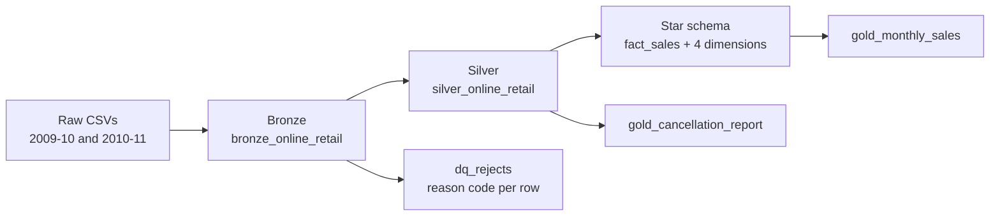

# Retail Sales & Cancellation Reconciliation Pipeline

Turns an untrusted transaction export into a validated, analysis-ready dataset so finance can trust the monthly revenue number. Built on Databricks with PySpark and Delta, using a medallion architecture and a star schema.

## Business problem
An online gift wholesaler's raw export has missing customers, non-product rows (postage, bank charges, tests), zero and negative prices, duplicated rows, and two yearly files that overlap in December 2010. Returns (invoices starting with `C`) have no link to the original sale. Finance could not answer: *"What was our real revenue last month?"*

## Architecture


## Dataset
[Online Retail II (UCI)](https://archive.ics.uci.edu/dataset/502/online+retail+ii): about 1.07M invoice lines, Dec 2009 to Dec 2011. Raw files are not included in this repo; download them and upload to a Databricks volume.

## Tech stack
Python, PySpark, SQL, Delta Lake, Databricks (Unity Catalog, volumes), Git folders.

## Repo structure
```
notebooks/
  01_ingest_bronze
  02_profile_raw_data
  03_silver_clean
  04_gold_dimensional_model
  05_reports_cancellations_monthly
docs/
  data_quality_findings.md
  screenshots/
```

## Pipeline
| Layer | Table | What happens |
|---|---|---|
| Bronze | `bronze_online_retail` | Raw rows from both files, plus audit columns (source file, row id, ingest time) |
| Silver | `silver_online_retail` | Text standardised, missing customers mapped to -1, rule-based rejects, duplicates flagged, `line_amount` derived |
| Rejects | `dq_rejects` | Every excluded row with one reason code. Nothing is silently deleted |
| Gold | `fact_sales`, `dim_customer`, `dim_product`, `dim_country`, `dim_date` | Star schema. Grain: one invoice line |
| Gold | `gold_cancellation_report` | Each return matched to earlier purchases: FULL, PARTIAL, UNMATCHED |
| Gold | `gold_monthly_sales` | Gross sales, cancellations, net sales per month |

## Key design decisions
- **Explicit reject list, not a regex.** Codes like `DCGS0058` look odd but are real products.
- **One reject reason per row**, assigned by priority, so counts add up with no double counting.
- **Overlap removed by proof.** The 1 to 9 Dec 2010 window was shown identical in both files (`exceptAll` returned 0 both ways) before dropping one copy.
- **Within-file duplicates are flagged, not deleted**, because identical lines can be genuine. The revenue at risk is quantified.
- **Unknown customer kept** as surrogate key -1 so 22% of rows stay in revenue.
- **Idempotent writes** (`overwrite`), so re-running never double counts.

## Validation (all enforced with asserts)
| Check | Result |
|---|---|
| Bronze = Silver + Rejects | 1,067,371 = 1,033,062 + 34,309 |
| Fact rows = Silver rows | 1,033,062 |
| Fact revenue = Silver revenue | £18,981,261.50 |
| Monthly net = Silver revenue | £18,981,261.50 |
| Cancellation report rows = cancellation lines | 17,974 |
| No NULL surrogate keys, unique grain, unique dimension keys | Passed |

## Results
**Rejected rows (34,309, 3.2% of input)**

| Reason | Rows | Value excluded |
|---|---|---|
| OVERLAP_DUPLICATE | 22,523 | £377,488.45 |
| NON_PRODUCT_CODE | 5,813 | -£71,499.40 |
| STOCK_ADJUSTMENT | 3,391 | £0 |
| INVALID_PRICE | 2,582 | £0 |

**Cancellation matching (17,974 return lines)**

| Status | Lines | Share |
|---|---|---|
| FULL | 15,912 | 88.5% |
| UNMATCHED | 1,612 | 9.0% |
| UNMATCHED_NO_CUSTOMER | 332 | 1.8% |
| PARTIAL | 118 | 0.7% |

96.2% of returned units (451,992 of 469,882) were traced to an earlier purchase.

**Findings**
- Removing the file overlap prevents a £377K overstatement of December 2010 activity.
- 22.0% of Silver rows (£2.57M, 13.5% of net revenue) have no customer.
- Within-file duplicates put £53,862 (0.28% of net revenue) at risk.
- [Your finding on the Dec 2011 and Jan 2011 cancellation spikes]
- [Your finding on where UNMATCHED returns cluster]

## Assumptions and limitations
- Returns are matched by customer and product, ignoring price, so this is an approximation.
- Returns of purchases made before Dec 2009 cannot be matched.
- Returns with no customer cannot be linked to a purchase.
- `dim_product` keeps the most frequent description per stock code (no history tracked).
- The Dec 2011 month is partial (data ends 9 Dec).

## How to run
1. Download the dataset and upload both files to a Databricks volume.
2. Run the notebooks in order, 01 to 05. Each ends with validation asserts.